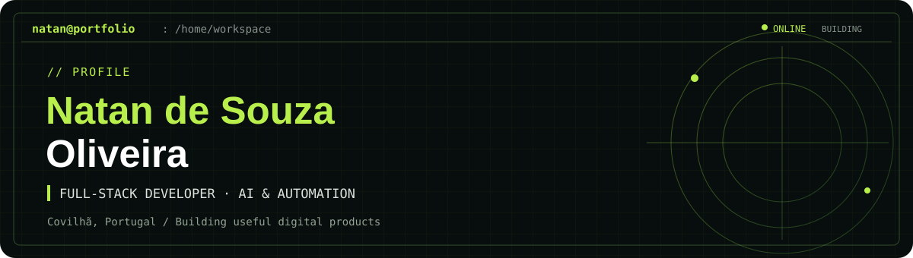

### Building useful software — from the interface to the API, database and deployment.

**Full-stack Developer · Computer Science & Engineering student at UBI · Covilhã, Portugal**

[About](#about-me) · [Selected Work](#selected-work) · [Tech Stack](#tech-stack) · [Experience](#experience) · [Contact](#contact)

---

## About me

Hey, I'm **Natan Oliveira** 👋

I'm a Brazilian full-stack developer based in Portugal. I enjoy taking an idea from its first sketch to a working product: **designing the UI, writing application logic, connecting APIs, modelling data and deploying the result**.

I've been working on freelance software projects since **February 2026**, alongside web development work with **Layout Agency**. I'm also pursuing a degree in **Engenharia Informática at Universidade da Beira Interior (UBI)**, building on my technical training in Informatics at **IF Sudeste MG**.

My interests span **web and mobile products, AI integrations, automation and interactive experiences**. I care about maintainable code, thoughtful UX and software that solves a real problem.

> **Currently:** building client-facing web experiences, developing personal products and studying computer science. Open to remote and part-time software opportunities.

## Selected Work

<table>
<tr>
<td width="50%" valign="top">
<h3>🎵 <a href="https://github.com/natsouzax/lexuri">Lexuri</a> · Featured full-stack product</h3>

<strong>Learn English through music, context and practice.</strong>

An evolving language-learning platform combining synced lyrics, vocabulary discovery, spaced review and AI-supported learning. Built across the product stack: frontend, authentication, database, AI integrations and deployment.

<code>Next.js</code> <code>React</code> <code>TypeScript</code> <code>Supabase/Postgres</code> <code>OpenAI</code>

<a href="https://lexuri-validacao.vercel.app/">Live prototype</a> · <a href="https://github.com/natsouzax/lexuri">Source code</a>

</td>
<td width="50%" valign="top">
<h3>🎮 <a href="https://github.com/natsouzax/game_jam">Together</a> · Game Jam</h3>

<strong>A cooperative climb through a ruined world.</strong>

A playable local co-op platformer built during a game jam. Players collect materials, build platforms and survive hazards while climbing a tower. Supports solo play, two controllers and keyboard input.

<code>GameMaker</code> <code>GML</code> <code>Gameplay logic</code> <code>Local co-op</code>

<a href="https://github.com/natsouzax/game_jam/releases/latest/download/Together_final.exe">Download for Windows</a> · <a href="https://github.com/natsouzax/game_jam">Source & screenshots</a>

</td>
</tr>
<tr>
<td width="50%" valign="top">
<h3>🤖 <a href="https://github.com/natsouzax/telegram-ai-automation-bot">Telegram AI Automation</a> · Python</h3>

<strong>Automated communication and useful content on Telegram.</strong>

An independently rewritten, anonymized portfolio demo inspired by a client automation project. Features bot commands, educational AI-generated tips, scheduled messages and lightweight subscriber storage.

<code>Python</code> <code>Telegram Bot API</code> <code>OpenAI</code> <code>SQLite</code>

<a href="https://github.com/natsouzax/telegram-ai-automation-bot">Explore the project</a>

</td>
<td width="50%" valign="top">
<h3>⚡ <a href="https://github.com/natsouzax/x-ai-content-automation">X AI Content Automation</a> · JavaScript</h3>

<strong>From an AI-generated draft to controlled social publishing.</strong>

A separate, anonymized demonstration of a content automation workflow: text and optional image generation, editorial checks, duplicate prevention, local history and explicit opt-in publishing through the X API.

<code>JavaScript</code> <code>Node.js</code> <code>OpenAI</code> <code>X API</code>

<a href="https://github.com/natsouzax/x-ai-content-automation">Explore the project</a>

</td>
</tr>
</table>

<strong>More projects and experiments</strong>

- **[Fluxo](https://github.com/natsouzax/fluxo)** — a React Native/Expo prototype for personal finances, notes and routines, with local-first persistence and an experimental assistant.
- **[LS Store interactive proposal](https://github.com/natsouzax/Interactive-proposal-for-LS-Store)** — an interactive Next.js proposal designed to make a client-facing product idea tangible.
- **[All public repositories](https://github.com/natsouzax?tab=repositories)** — coursework, prototypes, experiments and earlier projects.

## Tech Stack

| Area | Technologies |
| :-- | :-- |
| **Frontend & mobile** | React · Next.js · TypeScript · JavaScript · Tailwind CSS · React Native · Expo |
| **Backend & data** | Node.js · Python · SQL · PostgreSQL · Supabase · SQLite · REST APIs |
| **AI & automation** | OpenAI APIs · AI integrations · Telegram Bot API · X API · n8n · Make |
| **Workflow & deployment** | Git · GitHub · Vercel · Railway |
| **Beyond the web** | GameMaker/GML · Computer hardware troubleshooting · Arduino/ESP32 |

## Experience

- **2026–present · Freelance Full-Stack Developer** — web applications, prototypes, API integrations and practical software solutions for clients.
- **2026–present · Web Development, Layout Agency** — remote/hybrid work on websites and digital experiences.
- **2026–present · BSc in Engenharia Informática, UBI** — studying software development and computer science in Portugal.
- **Technical Informatics, IF Sudeste MG** — foundational training in programming, computer systems and technical support.

I work primarily in **Portuguese and English** and enjoy collaborating across disciplines.

---

### Let's build something useful.

I'm interested in full-stack development, product engineering and practical AI automation.

[Portfolio](https://natsouzax.vercel.app/) · [LinkedIn](https://www.linkedin.com/in/odevntzn) · [Email](mailto:oliveira.natan.dev@gmail.com) · [GitHub](https://github.com/natsouzax)

Built with curiosity in Covilhã, Portugal 🇵🇹

